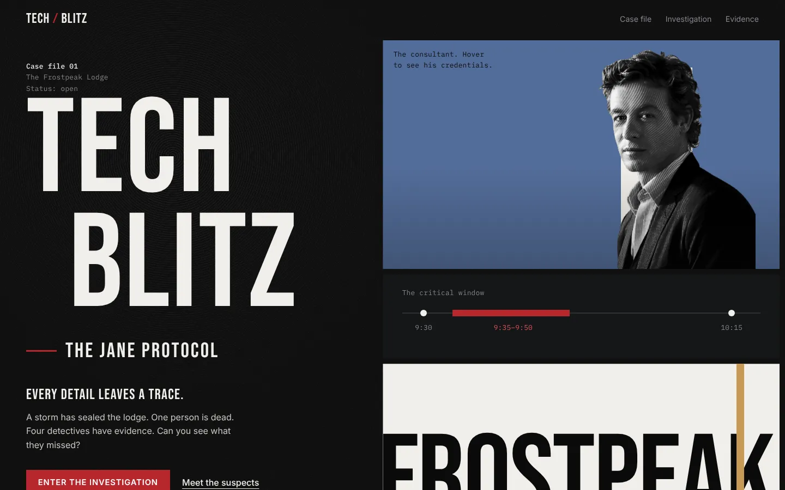
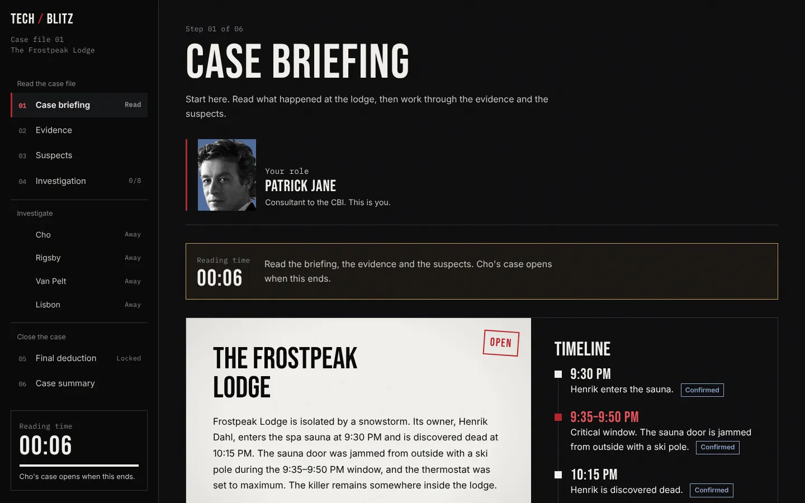
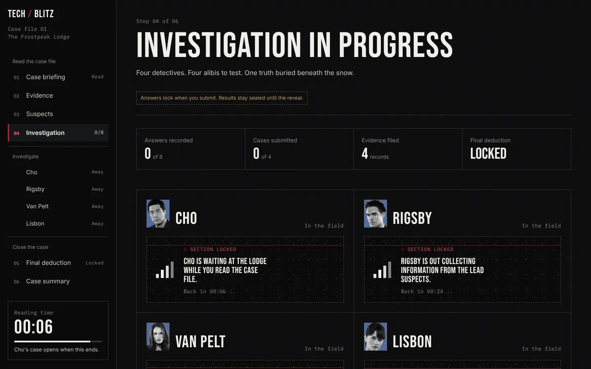
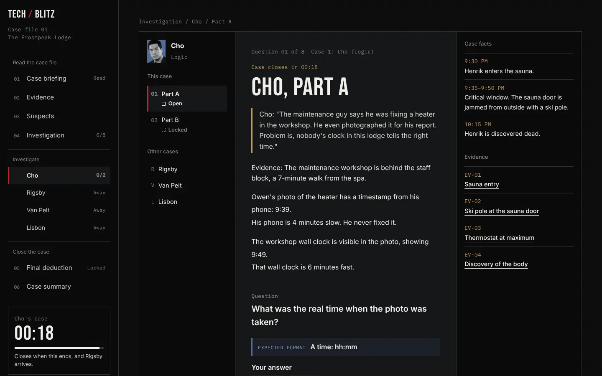
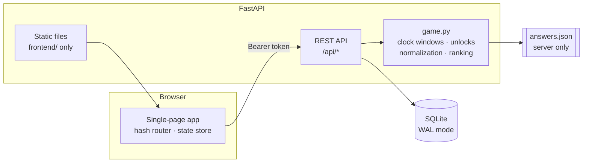
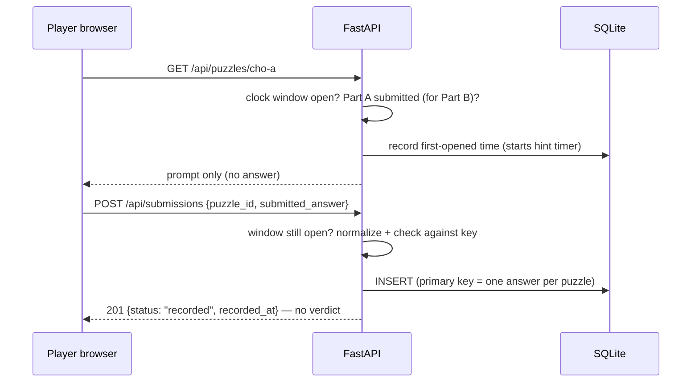

# TECH BLITZ — The Jane Protocol

A timed, solo **technical murder-mystery** built for a university tech event. Players act as consultant Patrick Jane, solve eight puzzles across four detectives' cases (logic, ciphers, number systems, C tracing) inside a server-run clock, then name the killer of the Frostpeak Lodge case. The event platform was gated by register number for fair play during the competition. This public edition keeps the same rules (server-owned clock, one locked answer per puzzle, hidden answer key) so the full case can be played without registration.



| Case briefing | Investigation dashboard | Puzzle workspace |
|---|---|---|
|  |  |  |

**Stack:** vanilla JavaScript single-page app (hash router, no framework) · Python **FastAPI** · **SQLite** · pytest · Playwright · deployable to Render.

---

## Why it's interesting

Running a live competition in a shared PC lab means the browser can't be trusted. Players can open devtools, change their system clock, refresh, or open a second tab. So the design rule is: **the server is the single source of truth.**

| Problem | How it's handled |
|---|---|
| Answers visible in page source | The answer key lives only in `backend/data/answers.json`, which is never served. Puzzle prompts are sent **one at a time, only once unlocked** (a later prompt can reveal an earlier answer). |
| Players changing their PC clock | Every case window is computed on the server from the player's start time. The browser only displays a countdown, corrected by the measured server–client offset. Late submissions are rejected (`410`). |
| Double submissions / race conditions | One answer per puzzle is enforced by a database primary key. Two simultaneous submits → one `201`, one `409`. |
| Refreshing to restart the clock | Starting the clock is idempotent (`UPDATE … WHERE t0 IS NULL`). The session token is kept in `localStorage`, and state is rehydrated from `GET /api/state` on load. |
| Correctness hints mid-event | Responses never include right/wrong. Results are sealed until an organizer releases them with an admin key. |
| Hint abuse | Hints unlock 5 minutes after the server first served that puzzle, are single-use, and add a 60 s penalty to ranking. |

## Architecture



### Request flow for one answer



## Game rules (as implemented)

- **Schedule:** 5 min reading → Cho 15 → Rigsby 15 → Van Pelt 15 → Lisbon 20. Cases open **on the clock**, not on correctness. Finishing early means waiting for the next detective.
- **Parts:** Part B opens when Part A is **submitted** (right or wrong).
- **Answers:** one submission per part, locked immediately. Checking is case-insensitive and whitespace-tolerant. Times like `09:43`, `9.43` and `943` compare equal.
- **Accusation:** opens when all four cases are closed (both parts submitted or time up). One choice, final.
- **Ranking (configurable in `game.rank_key`):** correct accusation → cases cleared (both parts right) → correct answers → lowest total time (time from each case opening to each submission, plus hint penalties).

## API

| Method | Path | Purpose |
|---|---|---|
| POST | `/api/session` | Check in with a name → `{participant_id, token}` |
| POST | `/api/clock/start` | Start this player's case clock (idempotent) |
| GET | `/api/state` | Server time, clock windows, puzzle metadata, own submissions, hints, accusation |
| GET | `/api/puzzles/{id}` | Prompt for an unlocked puzzle (`423` locked, `410` time's up) |
| POST | `/api/submissions` | Record an answer (`409` already answered, `410` too late) |
| POST | `/api/hints` | Use the hint (`425` not yet available) |
| POST | `/api/accusation` | Name the killer once (`423` until cases close) |
| GET | `/api/results` | Own rank and outcome, after release |
| POST | `/api/admin/release` | Organizer: release or re-seal results (`X-Admin-Key`) |
| GET | `/api/admin/leaderboard` | Organizer: ranked board (`X-Admin-Key`) |
| GET | `/api/docs` | Interactive OpenAPI docs |

## Run locally

Requires **Python 3.10+** (tested on 3.13).

```bash
cd backend
python -m venv .venv && source .venv/bin/activate      # Windows: .venv\Scripts\activate
pip install -r requirements.txt
TB_TIME_SCALE=0.1 TB_ADMIN_KEY=secret uvicorn app.main:app --reload
```

Open <http://localhost:8000>. `TB_TIME_SCALE=0.1` plays the 70-minute event in about 7 minutes. Use `1.0` for real timing.

**Release results** after everyone has accused:

```bash
curl -X POST localhost:8000/api/admin/release -H "X-Admin-Key: secret" -H "Content-Type: application/json" -d '{"released": true}'
curl localhost:8000/api/admin/leaderboard -H "X-Admin-Key: secret"
```

| Variable | Default | Meaning |
|---|---|---|
| `TB_ADMIN_KEY` | *(unset → admin disabled)* | Key for the organizer endpoints |
| `TB_TIME_SCALE` | `1.0` | Multiplies every timer (demo speed) |
| `TB_DB_PATH` | `backend/tech_blitz.db` | SQLite file |

## Tests

```bash
cd backend
pip install -r requirements-dev.txt
playwright install chromium
pytest            # 22 tests: API rules + one full browser run (~70 s)
```

- `tests/test_api.py` (21 tests) uses an **injected clock**, so time-based rules (windows, late submissions, hint delay) are tested instantly. It covers normalization, unlock order, lock-once (including 8 simultaneous submits), player isolation, hints, accusation, sealed results, ranking, and answer-key leak checks.
- `tests/test_e2e.py` starts a real server at 50× speed and drives Chromium through the whole event: check-in, locked cases, hint, submit, **reload persistence**, every puzzle, accusation, admin release and results. It watches every API response for answer-key leaks.

## Deploy (Render, free)

1. Push this repo to GitHub.
2. On [render.com](https://render.com): **New → Blueprint** → choose the repo. `render.yaml` configures everything (demo speed `0.1`, a generated admin key).
3. Copy `TB_ADMIN_KEY` from the service's Environment tab to release results.

The free plan's disk is temporary: player data resets when the service restarts or redeploys, which suits a demo. For a real event, attach a persistent disk and point `TB_DB_PATH` at it.

## Project structure

```
backend/
  app/main.py        API routes, auth, static serving
  app/game.py        pure game rules (clock, unlocks, normalization, ranking)
  app/db.py          SQLite schema + connections
  app/config.py      environment settings
  data/              puzzles.public.json (prompts) · answers.json (server-only key)
  tests/             API + end-to-end tests
frontend/
  index.html         the whole client: styles, router, screens, API client
  assets/            source images and bundled OFL fonts (also embedded in index.html)
docs/                screenshots
render.yaml          deploy blueprint
```

## Credits

Built by Harshitha Kamachi Balasubramaniam for TECH BLITZ, rebuilt so anyone can take the case. A fan-made tribute event inspired by *The Mentalist*: character names and images belong to their respective owners and are used non-commercially. Puzzle set by the TECH BLITZ organizing team. Fonts: Bebas Neue, Inter, IBM Plex Mono (SIL Open Font License).
